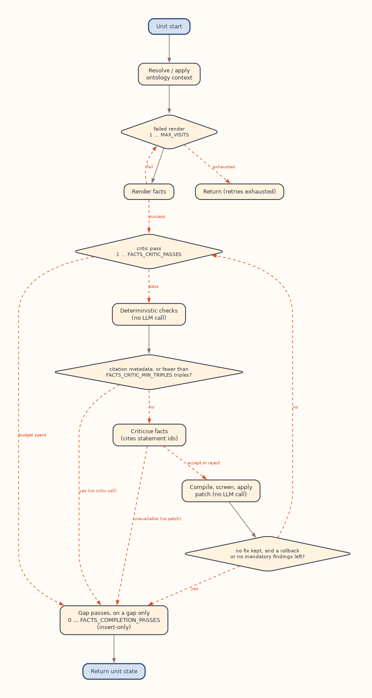
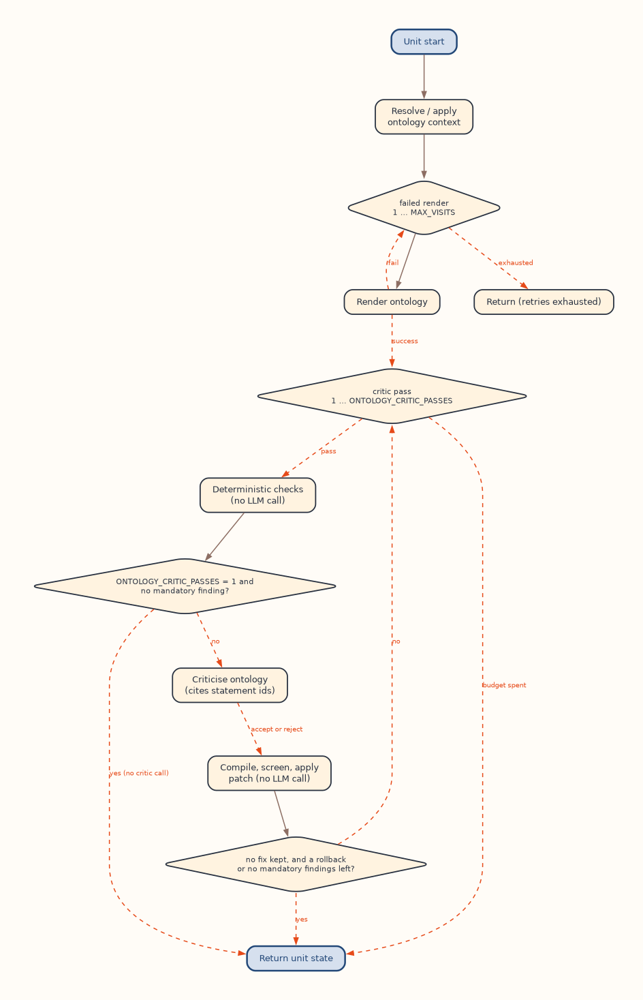

# Validation layers and the critic loop

This page describes how OntoCast checks and repairs what the model extracts:
the three validation layers, the per-unit render and critic loop with its
budgets, how a critique becomes a change to the graph, and what decides whether
a unit is accepted. [Validation and SHACL](../guides/validation.md) covers the
same ground from the user's side.

## The three layers

| Layer | Runs | Acts on | Module | LLM calls |
|---|---|---|---|---|
| 1. Parse-time repair | Inside every facts render | The rendered unit graph | `agent/render_facts.py`, `tool/facts_validation/literal_repair.py` | None |
| 2. Unit loop | Once per content unit, for facts and for ontology | The unit graph (facts) or the unit's delta (ontology) | `stategraph/atomic.py`, `tool/facts_validation/unit_findings.py`, `tool/ontology_validation/unit_findings.py`, `tool/facts_validation/critic_patch.py` | One per critic or completion pass |
| 3. Post-merge gate | Once per document, after aggregation (`VALIDATE_FACTS`, and the same gate on `/process_unit`) | The merged facts graph | `stategraph/facts_gate.py`, `tool/facts_validation/gate.py`, `tool/facts_validation/shacl.py` | None |

Ontology output has its own document-level checks after the unit loop: the
reduce-time policies, `STRUCTURAL_CHECK` and `CONSISTENCY_CRITIC`, all without
LLM calls ([below](#ontology-checks-after-the-unit-loop)).

Between aggregation and the gate, `RESOLVE_COREFERENCE` puts the entity pairs
the symbolic merge rules cannot settle to the model, in one call per document
of two or more units (`AGG_LLM_COREFERENCE`); its verdicts merge or veto pairs
and stay in force when the gate re-aggregates. [Entity
disambiguation](../concepts/entity_disambiguation.md#coreference-the-guards-cannot-settle)
describes it.

After the gate, `LINK_FACTS` (and the same pass on `/process_unit`) makes one
call per document that still has isolated instances (`FACTS_LINK_PASS`, off by
default): each is shown with the passage of its source unit that names it,
with up to eight instances it may link to and the object properties whose
domain and range fit; the model proposes only links the passage states. Code
keeps a proposal only when both ends are listed and one is isolated, the
property is a listed object property, the declared domain and range admit the
ends, a structured value (a QUDT quantity value or a schema.org structured
value) is reached only through a domain or range shown to fit it, a functional
property is still free, and the quoted evidence occurs in a source unit of the
isolated end. Each kept link is added with a reifier
deriving it from that unit; nothing is removed. The links are not re-checked
by the gate. Metrics: `facts_link_isolated`, `facts_link_proposed`,
`facts_link_added`, `facts_link_rejections_by_reason`; the links are on
`AgentState.facts_links_added`.

No layer withholds output. A unit that leaves the loop without being accepted
keeps its graph: the reduce merges it and logs it as salvaged from a
non-converged loop. The gate serves the facts it repaired, with the remaining
findings attached.

## The unit loop

Each content unit runs one loop per phase, written once in
`run_unit_loop` and parameterized by a `LoopPhase` (`FACTS_PHASE`,
`ONTOLOGY_PHASE`) that names the agents, the validator, the budgets and the
policies.

<figure class="oc-figure oc-figure--tall" markdown>

<figcaption>The facts loop for one content unit. Dashed edges are decisions; only the render, critic and completion steps call the model.</figcaption>
</figure>

1. **Resolve the ontology context** for the unit. For facts under per-unit
   shapes selection, the unit's shapes chapter is chosen from it here.
2. **Render.** A render that fails outright (no parseable output) is retried up
   to [`MAX_VISITS_PER_NODE`](../reference/configuration/pipeline.md#max_visits_per_node)
   (alias `MAX_VISITS`) times. A render that succeeds is never repeated:
   re-extracting a whole unit to fix a local defect costs a full call and
   brings new defects of its own. When web search is enabled and the failed
   render asked for it, the evidence is fetched and the render retried once
   within the same attempt.
3. **Critic passes**, up to the phase's budget. Each pass:
    1. collects the deterministic findings against the current graph (no call);
    2. checks whether the critic may be skipped (facts only, below);
    3. calls the critic, which sees the graph with numbered statements, the
       findings, the source text and, for facts, the shapes chapter;
    4. compiles the critique into one patch per fix, screens it, and applies
       the fixes one at a time (no call);
    5. re-derives acceptance from the patched graph.
4. **Completion passes** (facts only), when enabled and measurements are still
   missing.

A pass ends the loop early when it kept no fix and either rolled one back or
left no mandatory finding: the next pass would see the same graph and the same
findings, and pay for the same answer. If the critic call fails (timeout,
unparseable response), no patch is applied, the render is kept unreviewed, and
the unit leaves the loop marked failed at the critique stage.

### Budgets

- **`FACTS_CRITIC_PASSES`** defaults to 1, so a facts unit costs two calls: one
  render, one review. `0` leaves the findings to layers 1 and 3. In the default
  `selected_single_ontology` context mode each unit also makes one ontology
  selection call, counted as `llm/ontology_selection` in `budget.counters`.
- **`FACTS_CRITIC_MIN_TRIPLES`** skips the critic for a render with fewer
  triples; at the default it skips exactly the empty renders, which a critic
  would score perfect for nothing. Citation-metadata units are skipped too. A
  skip is recorded as `critic_skipped` and bills no call.
- **`ONTOLOGY_CRITIC_PASSES`** defaults to 0. The ontology loop then costs one
  call per unit, and its findings are collected once at the end for telemetry.
- **`FACTS_COMPLETION_PASSES`** defaults to 0 ([below](#completion-passes)).

All four are documented in the [facts-validation](../reference/configuration/facts-validation.md)
and [ontology-validation](../reference/configuration/ontology-validation.md)
references.

### The ontology loop

<figure class="oc-figure oc-figure--tall" markdown>

<figcaption>The ontology loop for one content unit.</figcaption>
</figure>

The ontology loop is the same loop with these differences:

- It renders against a copy of the unit's ontology snapshot and validates the
  unit's net insert/delete **delta**, never snapshot plus delta: that would
  attribute every existing catalog defect to the unit.
- At `ONTOLOGY_CRITIC_PASSES=1` the critic pass is spent only on a
  unit with a mandatory finding; a clean unit records a `critic_skipped`
  attempt with reason `no_mandatory_findings`. With 2 or more passes every pass
  runs. There is no completion pass.
- After the render and after each critic patch, a minted class or property
  without a label gets an `rdfs:label` derived from its local name
  (`PerovskiteSample` gives "Perovskite sample"), recorded as a `missing_label`
  repair and counted in `ontology/labels_derived`. An opaque local name
  (`Q42`, a hash) is left to the `missing_label` finding. A term of the catalog
  or of a well-known vocabulary is never labelled: an axiom on it is a reuse.
- Patches go through the unit's update channel, so the delta built at reduce
  time includes them; an update the channel refuses leaves the graph unchanged.
- The critic sees the retrieved catalog for judging term choices, but only the
  delta's statements carry ids, so a fix cannot delete shared catalog content.
- A rename is never allowed, and the delete limits are stricter
  (`ONTOLOGY_CRITIC_MAX_DELETE_SHARE`, `ONTOLOGY_CRITIC_MIN_DELETES`), because an
  ontology delete propagates to every document that uses the term.
- When a unit's context is a retrieved subset of the catalog (vector
  retrieval, per unit or as one document-scope union), the render and critic
  prompts carry a partial-context notice: a term absent from the prompt may
  simply not have been retrieved. A unit shown each ontology whole gets no
  notice.

## Layer 1: parse-time repairs

After a facts render is parsed, `_normalize_and_repair_graph` rewrites what a
machine can decide without the model:

| Repair | What it does |
|---|---|
| Numeric retyping | An untyped number on a property with a numeric range gets that datatype |
| `rdf:type` literal coercion | A type written as a string becomes the class IRI when it resolves unambiguously |
| Compact-IRI literal coercion | A plain string such as `"unit:NanoM"` on another predicate becomes the IRI, when its prefix is bound and either the schema says the predicate takes an IRI or the IRI is a catalog or fallback-vocabulary term. Critic and completion patches get the same repair before they are judged |
| Near-miss predicate rewrite | A predicate not in the catalog is rewritten to the one catalog term whose name tokens contain, are contained in, or equal its own. `FACTS_PROPERTY_ALIAS_MIN_RATIO` only breaks ties among such candidates; string similarity alone never triggers a rewrite. A predicate the full catalog declares is never rewritten, even when the unit's snapshot lacks it |
| Code resolution | A node carrying a code from `FACTS_CODE_PREDICATES` (such as `qudt:ucumCode "d"`) but no link to the coded individual gains that link, when exactly one catalog individual declares the code. The linking property comes from the schema's domain and range, or else from how the graph already links such nodes |
| Entailed types | A subject of a predicate with an `rdfs:domain`, or an IRI object of one with a class `rdfs:range`, gains that class as `rdf:type` when it has no type or the class specialises one it has. A type that would contradict the asserted ones is not added; that is the domain-violation finding's. Critic and completion patches get the same repair |
| Degenerate bounds | Equal lower and upper bounds become one value, when the quantity fallback vocabulary names `numeric_value`, `lower_bound` and `upper_bound` |

Two kinds of triple are then **quarantined**, removed from the graph and shown
to the critic for repair: typed literals whose lexical form is invalid for the
datatype, and string literals on a property whose range is a class
(`FACTS_OBJECT_PROPERTY_LITERAL_CHECK`).

Type and compact-IRI coercions, predicate rewrites, code resolutions and entailed types are recorded as
`GraphRepairRecord`s and returned per unit as `facts_repairs`, so a consumer can
tell a machine rewrite from what the model asserted. Ambiguity is never
resolved by guessing: two catalog terms claiming one code means no repair.

## Layer 2: findings and the critic

### Facts findings

`collect_unit_findings` runs before every critic call and after every applied
fix. Every kind is mandatory except numeric coverage:

| Finding | What it catches |
|---|---|
| `quarantined_literal` | A quarantined triple, with the catalog individuals of the property's range as suggestions |
| `unknown_term` | A term under `example.org`, a predicate or class minted in the facts namespace, or a term missing from a closed catalog namespace |
| `literal_type_object` | An `rdf:type` written as a string that layer 1 could not resolve |
| `domain_violation` | A predicate asserted on a subject whose stated type contradicts the predicate's `rdfs:domain` |
| `untyped_instance` | A facts-namespace IRI in subject or IRI-object position with no `rdf:type` naming a concrete class: one outside the facts namespaces that is neither a metaclass (`owl:Class`, `rdf:Property`, `owl:NamedIndividual`, …) nor vacuous (`owl:Thing`, `rdfs:Resource`, `schema:Thing`). Blank nodes and the chunk and document nodes are not instances. Suggestions are the domain and range classes of the predicates the instance carries, then catalog classes sharing a name token with its label |
| `domain_adherence` | Too few of the render's schema terms come from the ontology context (`FACTS_DOMAIN_ADHERENCE_MIN_SHARE`, judged from `FACTS_DOMAIN_ADHERENCE_MIN_TERMS` terms up); not judged on citation or non-content units |
| `scalar_as_bounds` | One value written into two single-valued numeric properties of one node |
| `label_only_number` | A value node with a unit but no numeric literal, whose number sits only in its label |
| `unit_symbol_case_mismatch` | A unit whose symbol matches the text only after case folding, while another catalog unit matches it exactly |
| `numeric_coverage` | Numbers in the source text missing from the graph, split into measurements (number with unit) and bare numbers. Advisory unless `FACTS_NUMERIC_COVERAGE_MANDATORY` says otherwise; `FACTS_NUMERIC_IDENTIFIER_GUARD` keeps digit groups of identifiers out |

The critic is told to resolve every mandatory finding by rewriting the
statement in place, never by deleting it.

### Which terms count as unknown

A namespace is **closed**, so that a member the catalog does not list is
reported, only when the ontology context *declares* terms in it (uses them as
subjects). A well-known namespace is the exception: its own term list closes
it, whatever part of it the catalog redeclares. A namespace the catalog only references, such as `qudt:` in an
`rdfs:subClassOf` or `owl:onProperty`, is a borrowed vocabulary and stays open.
Membership is checked against the whole catalog, not the unit's snapshot: a
term retrieval did not bring into the unit is still a term.

Never reported as unknown: the built-in meta-vocabularies (RDF, RDFS, OWL, XSD,
SKOS, Dublin Core, PROV), the other well-known vocabularies
(`ontocast.onto.well_known`: SOSA/SSN, OWL-Time, CSVW, DCAT, ORG, vCard, FOAF,
schema.org, QUDT), `FACTS_ADDITIONAL_STANDARD_NAMESPACES`, the terms of
`FACTS_QUANTITY_FALLBACK_VOCABULARY` (the prompt recommends them),
`FACTS_CODE_PREDICATES`, and every term the SHACL shapes require. Replacement
candidates are offered only by token containment and filtered by role, so a
property is never offered as a class or the reverse.

A well-known term must exist in its vocabulary, checked against rdflib's
bundled term lists (vCard and QUDT have none and are admitted by namespace).
One it does not have is `unknown_term` in both modes, with the vocabulary's
near-misses as suggestions; an ontology render that mints one gets
`foreign_namespace`.

Under `FACTS_VOCABULARY=strict` (the default) a term of any other vocabulary
the catalog neither declares nor borrows from is unknown as well: the facts are
a projection onto the catalog, the vocabularies it builds on, the well-known
vocabularies and the declared ones, and a statement they cannot express is
rewritten in their terms or left out. Under `open` only a member of a closed
namespace is unknown, and a term of another vocabulary passes.

At the gate, the shapes are cross-checked against these rules: a property the
shapes require that the term validator would flag is logged as an error once
per document, because no data can satisfy both.

### Ontology findings

`collect_ontology_unit_findings` runs on the delta. Every kind is mandatory
except `label_collision` and `specific_label_leaf`:

| Finding | What it catches |
|---|---|
| `foreign_namespace` | A term minted under a namespace no context ontology declares terms in; the reduce would drop it as unattributable. With a home ontology, its namespace is always accepted (a new home has no terms yet), and a new term under any other namespace is flagged, since the reduce drops it. Also `example.org` terms and ontology terms minted in a facts namespace |
| `foreign_delete` | A delete of catalog content whose subject the unit does not redeclare |
| `subclass_cycle` | An inserted `rdfs:subClassOf` that closes a cycle through snapshot and delta |
| `role_confusion` | A catalog class used as a property, or a catalog property used as a class |
| `degenerate_restriction` | An `owl:Restriction` with too few meaningful predicates to constrain anything |
| `cardinality_contradiction` | A functional or max-1 declaration contradicted by a minimum cardinality of 2 or more |
| `missing_label` | A new class or property without `rdfs:label` or `skos:prefLabel` |
| `label_collision` (advisory) | A new term whose label equals an existing term's in the snapshot |
| `hierarchy_too_deep` | A minted class more than `ONTOLOGY_MAX_CLASS_DEPTH` named-superclass steps below its root. A root is `owl:Thing`, a well-known vocabulary term, or a class with no named superclass; restrictions are not steps |
| `value_set_siblings` | Three or more minted subclasses of one parent whose labels differ in one word and that carry no subclass, property domain, restriction or definition of their own: a value set modelled as subclasses. The suggestions list the siblings |
| `specific_label_leaf` (advisory) | A minted leaf no property uses whose label carries a number, a chemical formula or four or more words |
| `catalog_duplicate` | A minted term whose label, preferred label, notation or local name equals, case-insensitively, that of exactly one catalog term of compatible role, anywhere in the catalog. The suggestion is the catalog IRI. An exact label match in the snapshot is left to `label_collision` |

`unknown_term` has no ontology counterpart, since minting terms is the ontology
render's job, and connectivity is left to `STRUCTURAL_CHECK`.

### How a critique reaches the graph

The critic cites statements by id. Every statement of the facts graph, and of
the ontology delta, carries a number in the critic's prompt (inline in Turtle,
in a `TRIPLE INDEX` table in JSON-LD). A fix names the ids in `triple_ids`:
`REMOVE` cites ids, `REPLACE` cites ids and supplies `correct_value`, `ADD`
supplies only `correct_value`. A fix that cites no id falls back to quoting the
statement in `incorrect_value`, which must match the stored triples exactly.

`compile_critic_fixes` turns each fix into a delete-then-insert patch, with no
LLM call. Payloads are parsed format-tolerantly: a Turtle payload under a JSON-LD
deployment, or a JSON-LD term object inside Turtle, is mapped to the equivalent
Turtle. A fix goes back unapplied, counted as residual, when it cites an id the
index never issued, names a prefix nothing declares, holds an invalid typed
literal, or would mint a placeholder subject (a name for an ignored token, or a
new node with annotations and no type). A fix that removes exactly what it
re-adds is counted as a no-op.

Screening then withholds what a pass may not destroy:

| Rule | Why |
|---|---|
| Deletes only by cited id or exact quote | A statement the critic was not shown cannot be removed |
| `FACTS_CRITIC_MAX_DELETE_SHARE`, with a `FACTS_CRITIC_MIN_DELETES` floor | Past the share a critique is rewriting, not correcting; over it, every fix that deletes goes back whole and only pure additions are kept. The floor keeps short units correctable |
| A `REMOVE` may not empty a subject | Removing the last statement about a node deletes the node |
| A `REPLACE` may not write about a different subject than it deletes | That is a rename: it orphans the old node and leaves the new one bare. `FACTS_CRITIC_ALLOW_SUBJECT_RENAME` opts in (facts only) |
| A blank-node structure is deleted whole or not at all, at any depth | A partial delete leaves a stub; a structure another subject still points at stays |
| A value is addressed through its carrier | A structured value is a blank node, so a fix names the statement that carries it, never the value as a subject |

The surviving fixes are applied **one at a time**, each judged against the graph
the previous kept fix left. A fix is rolled back on its own when it:

- deleted and wrote nothing (`delete_only`), judged against what the fix
  declared it writes, so a `REPLACE` whose replacement was already present is
  not mistaken for a bare delete;
- created mandatory findings (`new_mandatory`);
- shrank the unit without resolving anything (`no_progress`).

An applied or rolled-back fix is not requested again. In the facts phase,
applied critic fixes are recorded as `critic_fix` repair records.

### What makes a unit acceptable

Acceptance is `material_defects()` over evidence that can be pointed at:

| Signal | Blocks? |
|---|---|
| Mandatory deterministic finding (facts) | Always |
| Ontology finding in `ONTOLOGY_ACCEPT_BLOCKING_FINDING_KINDS` | Yes; the default set is `foreign_delete`, `foreign_namespace`, `subclass_cycle`, `role_confusion`, `hierarchy_too_deep` |
| Critic fix at or above `FACTS_ACCEPT_BLOCKING_SEVERITY` (default `critical`; applies to both phases) | Yes |
| Critic fix with action `REMOVE` | Never: a deletion is never worth holding a unit back for |
| Advisory findings | No |
| The critic's `score` and `success` | No; recorded as telemetry only |

`FACTS_ACCEPT_BLOCKING_SEVERITY=never` lets deterministic findings decide
alone. Acceptance is decided when the critique arrives and re-derived after the
patch, from the post-patch findings and the fixes still outstanding. It sets the
unit's status, which the reduce reads for its salvage count, and a rejected
critique may trigger the critic's web-evidence retry; it never discards the
unit's output. `facts_critic_accepted` counts the critic calls that accepted.
The ontology critic also records, as `incumbent_accepted` on each attempt, what
a score rule (`success`, or a score above 90) would have decided.

### Completion passes

The critic judges whether what was rendered is right, not whether something is
missing. `FACTS_COMPLETION_PASSES` adds insert-only passes after the critic
loop, run only while the numeric inventory still lists a measurement (a number
with its unit) absent from the graph. Each pass:

- shows the model a term sheet (the unit's quantity, observation and condition
  classes and unit individuals) instead of the full ontology chapter, plus the
  unit's existing catalog-typed subjects, so a recovered measurement attaches
  to a node that is already there;
- keeps only `ADD` fixes, whatever else the model returns;
- applies them through the same one-at-a-time regression check as critic
  fixes.

The passes stop as soon as nothing is missing.

## Layer 3: the post-merge gate

`run_facts_gate` runs on the aggregated graph, in this order:

1. **Literal variants** that differ only in language tag or datatype on one
   subject and predicate are collapsed (`FACTS_LITERAL_VARIANT_DEDUPE`): the
   language-tagged form wins, then the plain one, and provenance moves to the
   survivor.
2. **Invariant checks** (`validate_aggregated_facts`), reported only for
   subjects in the facts namespaces:

    | Finding | Severity | Acted on by |
    |---|---|---|
    | `functional_violation`: two or more objects on a functional or max-1 property | error | un-merge |
    | `suspect_multi_value`: two numeric values on one property; irreconcilable short strings on a property that is single-valued for most subjects; or two IRIs on such a property | `FACTS_SUSPECT_MULTI_VALUE_SEVERITY` | un-merge when an error |
    | `degenerate_coreference`: one IRI object shared by two single-valued properties of a subject | error | un-merge |
    | `shacl` | from the shape | autofix |
    | `non_catalog_vocabulary`: a term neither the ontology context nor the catalog has | a term of an existing well-known, declared or fallback vocabulary: warning; any other term, or a well-known term that does not exist: error under `FACTS_VOCABULARY=strict`, warning under `open` | reported (a retrieval miss, or outside the projection) |
    | `dangling_reference` | warning | reported |
    | `mixed_object_kinds`: a property used with both IRI and literal objects | warning | reported |

    String values on a cluster confirmed by a natural key are reported as
    warnings. With `FACTS_SUSPECT_MULTI_VALUE_REQUIRE_CROSS_UNIT`, two IRI
    objects asserted by a single unit are a warning: only objects from
    different units can come from a bad merge.
3. **Un-merge repair** (document path only). The first three kinds are merge
   signatures: two things that are not the same got one IRI. A finding
   implicates a cluster: the subject's for `functional_violation` and
   `suspect_multi_value` (a merged subject collects its members' objects, so
   the objects are left merged), the subject's and the objects' for
   `degenerate_coreference`. Within it, only the members that disagree are
   vetoed as pairs: two members whose values on the finding's predicate, in
   their own units, are all incompatible (for `degenerate_coreference`, which
   of its predicates they use or are reached by). Members that carried no
   value keep their merges; when no pair disagrees, the whole cluster is
   vetoed. The units are re-aggregated with these vetoes and the coreference
   verdicts, up to
   `FACTS_MERGE_REPAIR_PASSES` times; a pass is kept only if the
   merge-signature error count strictly drops. SHACL findings never drive this
   loop: a missing property says a node is under-specified, not that two
   entities were confused.
4. **SHACL autofix** (`apply_shacl_repairs`), on the graph that will be served,
   reusing the violations already computed. The modes and their guards are in
   [Validation and SHACL](../guides/validation.md#llm-free-autofix). A pass is
   kept only if the violation count drops. A prune also removes a referrer the
   prune leaves empty, and repairs touch only nodes in the facts namespaces.
   Rewrites move the statement's RDF 1.2 reifier onto the replacement; prunes
   delete it.
5. **Untyped instances**. While any instance lacks a concrete type (the
   `untyped_instance` rule, over the aggregated graph so a type asserted in any
   unit counts), the gate first materialises the types the domains and ranges
   of their links entail (`materialize_entailed_types`, the parse-time repair)
   against the whole ontology context, which a unit's own context may have
   lacked; instances it types are counted as `facts_untyped_inferred` and their
   records are kind `entailed_type`. Then every instance still untyped
   (`drop_untyped_instances`) is removed with every triple it is the subject or
   object of, the blank nodes reachable only through those triples, and the
   reifiers quoting them. Each drop is a `facts_gate_repairs` record of kind
   `untyped_dropped`; the IRIs are on `facts_untyped_dropped` (capped at 200)
   and the count is the `facts_untyped_dropped` metric. Then every instance
   that states nothing (`drop_unlinked_instances`: linked to no other
   instance nor the document, with no value of its own, only a type and
   names) is removed the same way, and so is every blank-node value no
   statement carries; records are kind `unlinked_dropped`, and the
   `facts_unlinked_dropped` metric counts both.
6. **Connectivity**: `facts_links_removed` counts the links between instances
   that steps 4 and 5 removed; `facts_components` and `facts_isolated` count the
   connected groups of instances in the served graph and the instances linked
   to no other instance (links run through blank nodes; the document node joins
   what it links but is not an instance; typing, `owl:sameAs` and the
   pipeline's provenance link nothing, while a domain property links in any
   vocabulary, PROV-O included). An isolated instance left holds a value of its
   own; the gate hands these to the link pass (`facts_isolated_instances`),
   which rewrites `facts_isolated` and `facts_components` for the graph it
   serves. `facts_twin_labels` counts the labels two or more instances share.
   Then each blank-node value is named under its carrier
   (`<carrier>.<property>`), with the reifiers of its statements repointed.
7. **Summary**: `facts_conformance`, `facts_validation_findings` and
   `facts_gate_repairs`, plus the gate counters in `retrieval_metrics`.

SHACL runs on a copy of the data graph with the ontology context mixed in and
`FACTS_SHACL_INFERENCE` applied. Shapes come from the shapes partition and from
any `sh:NodeShape` inline in the ontology context. `/process_unit` runs the same
gate without step 3, since one unit has nothing to un-merge.

## Ontology checks after the unit loop

The per-unit snapshot under `selected_vector_search_ontology` is a retrieved
subset of the catalog, so judgments that need the whole catalog run at the
reduce step, where the catalog heads are loaded. The clean-up rules (external
subjects through `Thing`) run first, before reconciliation and the term
decisions see the delta:

| Policy | Behavior | Counter |
|---|---|---|
| Minted-term reconciliation (`ONTOLOGY_RECONCILE_MINTED_TERMS`, default `detect`) | A new term whose label, preferred label or notation, or else local name, equals case-insensitively that of exactly one catalog term of compatible role, in any catalog ontology, is a re-mint of a term retrieval did not surface. `detect` logs the pairs, `rewrite` substitutes the catalog IRI in the merged update, `off` skips the check | `minted_duplicates`, `minted_duplicate_pairs`, `minted_duplicates_rewritten` |
| Delete policy | A unit can delete only what its context showed it: its deletes are the context statements its updates removed. A delete from a unit whose context was a retrieved subset is dropped unless the document's merged inserts redeclare its subject: it was judged on partial evidence and would change shared catalog terms. Deletes from units shown their ontologies whole are kept | `deletes_dropped_unredeclared` |
| Fresh-ontology reconciliation | Units that rendered fresh each produced terms under the document's one home ontology; their graphs are unioned into one root. A fresh unit under any other IRI is a fault and stops the run | `fresh_ontologies_merged` |
| External subjects | A triple whose subject lies in the namespace of an external ontology (one not under `CURRENT_DOMAIN`), or under a path of it, is removed: external terms are used, never changed | `external_subject_refused` |
| Example namespaces | A triple naming an IRI under `example.org`, `example.com` or `example.net` outside `CURRENT_DOMAIN` is removed: the model took a placeholder namespace from a prompt example | `example_namespace_dropped` |
| Minted outside home | A term the delta newly declares (not in the catalog) under any namespace other than the home ontology's is removed: every new term of a document lives under its home namespace. Under the deployment's own domain every triple naming the term goes; in another vocabulary only the statements about it go, and a home axiom pointing at it stays as a reuse. A term counts as declared when it is typed as a class, a property or a SKOS concept, or carries a subclass, subproperty, domain, range, equivalence, inverse or disjointness axiom; a term of a well-known vocabulary is never newly declared | `minted_outside_home_dropped` |
| Non-term subjects | A subject in the facts namespace, an individual (typed, but neither as a class, a property nor a SKOS concept), or an untyped subject that neither the catalog nor a subclass, domain or range axiom declares is removed: an ontology update declares terms and value sets, and the rest belongs in the facts graph | `non_term_subjects_dropped` |
| Datatype ranges | A property with several datatype ranges keeps one: `rdfs:Literal` goes beside a concrete datatype, and of several concrete ones the first of `rdf:langString`, `xsd:string`, then numbers from wide to narrow, then time, stays. Several ranges mean their intersection, empty for two datatypes | `datatype_ranges_normalized` |
| `Thing` | `owl:Thing` or `schema:Thing` as a range or domain, or as a parent beside another parent, is removed: it constrains nothing | `vacuous_upper_terms_dropped` |
| Parent kind | A property's `rdfs:subPropertyOf` naming a class or a datatype (`schema:Property` and `rdf:Property` are classes), and a class's `rdfs:subClassOf` naming a property or a datatype, are removed. A parent's kind comes from the delta's own declarations, then the catalog, then the well-known vocabulary's naming: classes capitalised, properties not, XSD terms datatypes. A parent of unknown kind stays | `role_crossing_parents_dropped` |
| Home target | The home ontology is always a write target. When it is not stored yet and no unit rendered it fresh, an empty root under its identity receives its terms; under vector retrieval units render updates against catalog patches even for a new home | — |
| Blank nodes | A blank node and every blank node connected to it are one blank-node structure (a restriction, a list, an anonymous axiom), with the named subjects that point at it as its anchors. Every rule above removes a structure whole: when one of its statements goes, or when every statement pointing at it goes, the structure goes with those statements. No restriction is left half-written or orphaned | — |
| Fresh renders | A fresh ontology is filed like an update: its header and the statements its home owns stay, a statement whose subject another writable ontology owns joins the delta for that ontology, and one no writable ontology owns is removed | `fresh_triples_refiled`, `fresh_triples_unattributed` |
| Attribution | A triple goes to the writable ontology that owns its subject's namespace: an ontology owns the namespace of its IRI, and a namespace it only binds as a prefix only when no writable ontology owns that one outright. A named subject no writable ontology owns is dropped, never filed by its predicate or object. A blank-node structure goes whole to the owner of its anchors, or, with no anchor, to the owner of its `owl:annotatedSource`, else to the single owner of the named terms it uses; with several owners or none it is dropped, with the statements pointing at it. An external ontology owns its namespace but receives nothing: what it would own is dropped | `unattributed_insert_triples` |

## The ontology plan and term decisions

Before the units render, the document plan's proposals are checked against the
whole catalog, without a model:

- a proposal whose `reuse` names a catalog or well-known term of compatible
  role (a class never reuses a property; a well-known term's role is read
  from its vocabulary's naming, so a property never reuses `schema:Property`)
  is a reuse of that term;
- a proposal whose label or local name names exactly one catalog term of
  compatible role becomes a reuse of it;
- a second proposal with the same local name or label is refused, and so is
  every proposal past `ONTOLOGY_PLAN_MAX_TERMS`;
- a parent must be a catalog term, a well-known term or another accepted
  proposal, of the term's own role; any other parent is dropped and the term
  kept;
- a plan with no term counts as no plan, so units render without one.

Counters: `plan_proposed`, `plan_minted`, `plan_reused`,
`plan_resolved_to_catalog`, `plan_rejected`, and `plan_failed` / `plan_empty`
when no plan reached the units.

A reused term is never minted, so the facts lane would not see it. Before the
facts units render, every reused term the facts ontology context does not
define is added to it: a catalog term with its catalog definition, a
well-known term declared from the plan entry (its kind, label and the plan's
definition). This holds for every facts context: the merged document
context, and a unit's own when the document wrote no ontology (a plan that
only reuses terms). Counter: `ctx/admitted_planned_terms`.

At reduce, after the merge and the reconciliation above, every minted term
(a class or property neither the catalog nor a well-known vocabulary holds)
gets one action. A minted term is planned when its IRI, its local name
(case-insensitive) or one of its labels matches a plan entry; any other is a
candidate.

The model is asked only about terms that need a decision: candidates, and
minted terms that carry a term-level finding (`specific_label_leaf`,
`value_set_siblings`, `catalog_duplicate`, `label_collision`,
`hierarchy_too_deep`), name an existing catalog term, sit in a value-set
family, or vary another term's name by one modifier (`hasOpticalCavity` and
`hasOpticalMicrocavity`). Each of those gets a full entry; the document's other
minted terms are listed one line each, as possible merge targets. When no term
needs a decision, no call is made and the defaults apply. The actions are
validated before they are compiled:

| Action | Valid when | Effect on the document's update |
|---|---|---|
| `keep` | always; the default for a planned term | none |
| `merge_into T` | `T` is a minted, catalog or well-known term of the same role, and the merge chain ends at a term that survives | the term's own triples go; every other triple naming it names `T` |
| `generalise_to T` | as for a merge | its named parents are replaced by `T` |
| `demote_to_property_value` | the term is a class | its class typing and named superclasses go; it becomes an `owl:NamedIndividual` and `skos:Concept` with its former parents as `skos:broader`; subclasses and domain/range uses move to its former parent |
| `drop` | always; the default for a candidate | every triple naming it goes |

An action on a term the document did not mint or the model was not asked
about, a second action on one term, or an invalid target is ignored and the
default applies, so a catalog term's own
axioms are never edited. Counters: `minted_terms_before_decisions`,
`plan_candidates` (and `plan_candidate_iris`), `plan_candidates_dropped`,
`consolidation_flagged`, `consolidation_skipped`,
`consolidation_keep` / `_merge_into` / `_generalise_to` /
`_demote_to_property_value` / `_drop`, `consolidation_actions_ignored`,
`consolidation_changed_triples` and `consolidation_calls_failed`.

## Applying the merged update

Applying the merged delta also counts where the unit's view and the catalog
diverged: `apply_deletes_no_match` (delete triples absent from the catalog at
apply time, typically a stale vector index),
`unattributed_insert_triples` / `unattributed_delete_triples` (triples no
writable ontology claims, the loss `foreign_namespace` predicts) and
`apply_header_triples_dropped` (statements on the ontology IRI itself, and the
blank-node structures only they point at, dropped because the version header is
written by code, never by a render). Deletes keep the catalog's blank-node
structures whole: a delete of every statement pointing at a structure removes
the structure too (`apply_structure_deletes_expanded`), and a delete of part of
a structure that something still points at is dropped
(`apply_structure_deletes_dropped`).

`minted_classes` counts the classes the document minted. When the run renders
both lanes, the facts gate adds `unused_minted_classes` and
`unused_minted_class_iris`: minted classes that no fact of the same document
instantiates.

These counters are kept in `AgentState.ontology_reduce_metrics` and written to
the run manifest of `ontocast process` under `ontology_reduce_metrics`. The
`/process` response does not include them. A minted duplicate also logs a
warning naming both IRIs.

After reduction, `STRUCTURAL_CHECK` checks each resulting ontology for
disconnected components and unlabeled predicates, and `CONSISTENCY_CRITIC`
(vector mode only) re-queries the vector store for terms that look like ones in
an ontology the document did not use. Both add to `improvement_suggestions`
and change nothing.

## Telemetry

Per-unit attempt logs feed the `critic`, `ontology_critic` and `completion`
blocks of the run manifest; `retrieval_metrics` carries the per-document totals
(`facts_critic_calls`, `facts_critic_accepted`,
`facts_critic_patches_rolled_back`, `facts_mandatory_residual`,
`ontology_mandatory_residual`, the `facts_shacl_*` and `facts_merge_*`
counters). [Reading run telemetry](../guides/telemetry.md) explains them.
